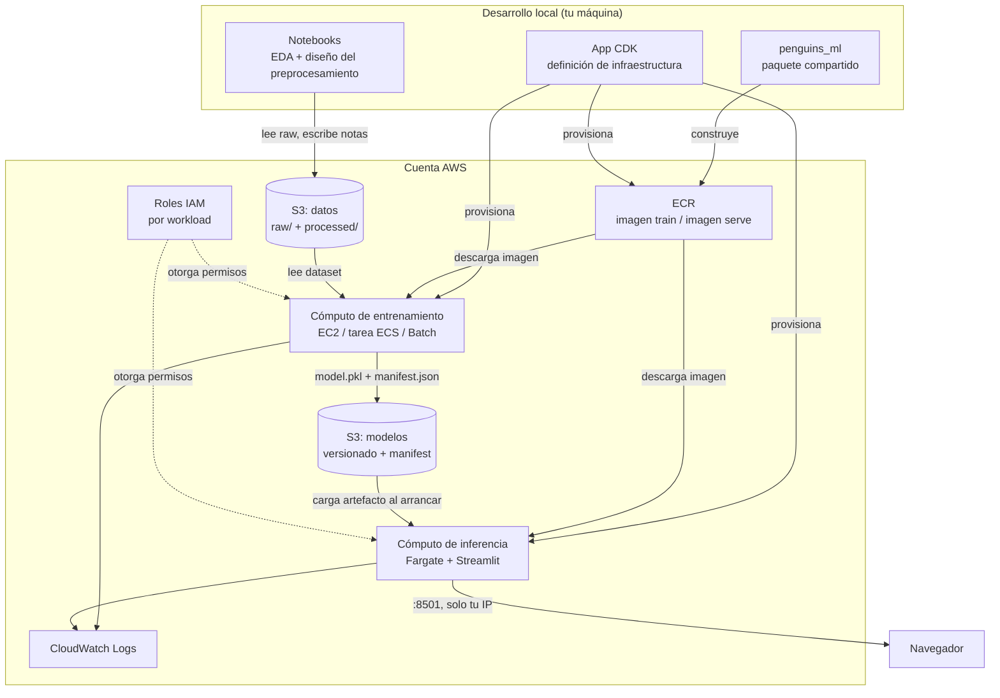
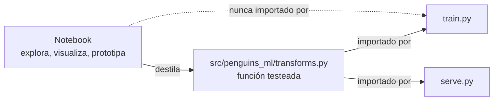
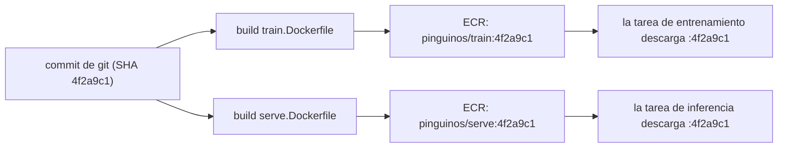
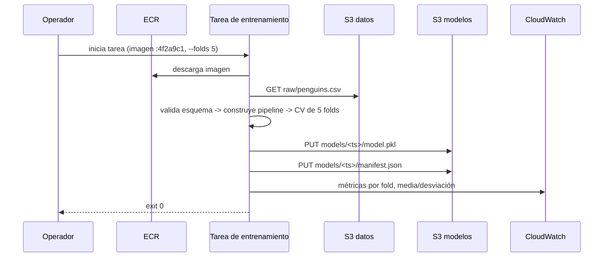
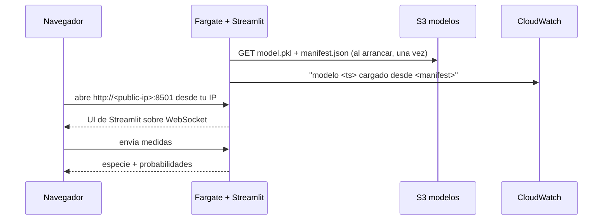
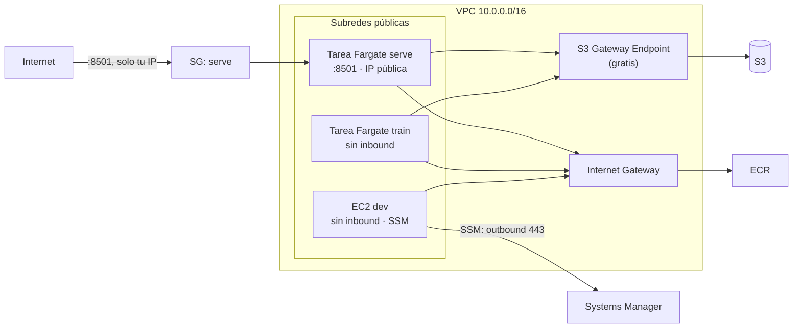
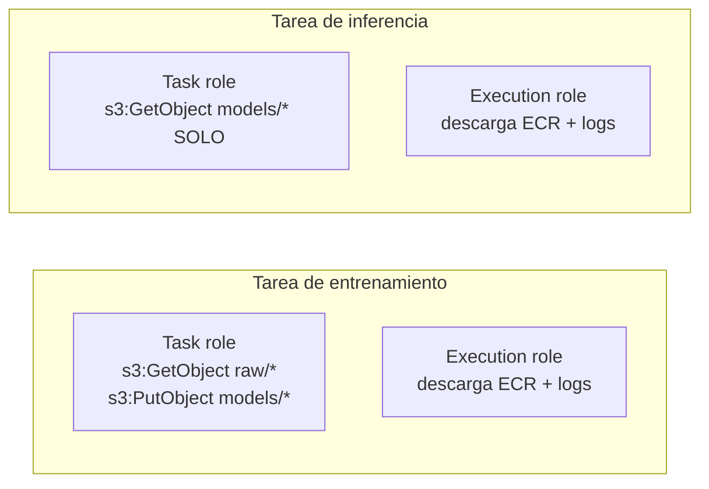
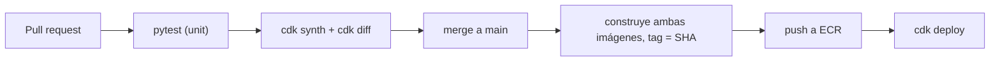

# Pinguinos — Arquitectura de plataforma ML

> Proyecto de aprendizaje: levantar infraestructura real en AWS para un ciclo de vida ML pequeño.
> El dataset Palmer Penguins (~344 filas) es deliberadamente trivial — lo importante es la
> **forma del pipeline**, no el modelo. Cada componente de abajo se transfiere sin cambios a un
> dataset mil veces más grande.

Estado: documento de diseño. Nada de esto está implementado todavía.

---

## 1. Objetivo y alcance

Construir, desde cero, una infraestructura que soporte:

1. Datos crudos almacenados en S3.
2. Análisis exploratorio en notebooks para entender y diseñar el preprocesamiento.
3. Un paquete Python versionado (`src/`) con las transformaciones finales y el código de entrenamiento.
4. Entrenamiento con validación cruzada en cómputo dedicado.
5. El modelo entrenado persistido en S3 con procedencia completa.
6. Inferencia en cómputo separado, expuesta mediante una interfaz web con Streamlit.

**Fuera de alcance por ahora:** feature stores, streaming en tiempo real, Kubernetes, landing
zones multi-cuenta, entrenamiento con GPU. Son temas de Fase 6 en adelante.

**Criterio de éxito:** puedes señalar cualquier predicción y responder *qué modelo la produjo,
de qué dataset, con qué código, entrenado cuándo*. Si no puedes responder eso, la
infraestructura no está terminada.

---

## 2. Principios guía

Estas cuatro reglas evitan la mayoría de los modos de falla descritos abajo. Léelas antes de
los diagramas.

### 2.1 Entrenamiento e inferencia son ciclos de vida distintos

| | Entrenamiento | Inferencia |
|---|---|---|
| Duración | Minutos u horas, y muere | Semanas o meses, siempre arriba |
| Tamaño de máquina | Grande, bursty | Pequeña, estable |
| Modo de falla | Se reintenta completo | Degrada, nunca se cae |
| Modelo de costo | Pagas por ejecución | Pagas por tiempo encendido |

No los pongas en la misma máquina. Es el error de principiante más común y el más caro.

### 2.2 El artefacto del modelo es el contrato entre ambos

Entrenamiento e inferencia se comunican **a través de un archivo**, nunca mediante memoria
compartida ni un sistema de archivos compartido. Ese archivo es la costura que permite que cada
lado sea desplegable, testeable y reemplazable de forma independiente.

### 2.3 El código de preprocesamiento se comparte, no se duplica

Si el notebook escala las features de una manera y el contenedor de inferencia las escala de
otra, tienes **train/serve skew** — el modelo se degrada en silencio en producción mientras
todos los tests pasan. La solución es estructural: un solo paquete, importado por ambas
imágenes, versionado por el SHA de git.

El artefacto no es "un estimador". Es un **`sklearn.pipeline.Pipeline` entrenado** que incluye
imputación, codificación y escalado. Serializar el pipeline completo es lo que hace al artefacto
autocontenido.

### 2.4 Todo recurso es destruible

`cdk destroy` debe llevar el costo del mes a cero. Eso implica `RemovalPolicy.DESTROY` en los
recursos de aprendizaje, sin volúmenes EBS huérfanos, con retención de logs acotada, y sin
cómputo siempre encendido que se te olvidó.

---

## 3. Vista general del sistema



Las dos costuras horizontales — `S3: modelos` y `ECR` — son lo que te permite cambiar un lado
sin tocar el otro.

---

## 4. Análisis por componente

### 4.1 Capa de almacenamiento

Un solo bucket alcanza para empezar; los prefijos llevan la semántica.

```
s3://pinguinos-<cuenta>-<region>/
├── raw/
│   └── penguins.csv                    # inmutable, nunca se sobrescribe
├── processed/
│   └── v1/penguins.parquet             # opcional, para iterar más rápido
├── models/
│   └── 2026-10-31T18-40-12Z/
│       ├── model.pkl                   # Pipeline entrenado
│       └── manifest.json               # procedencia
└── reports/
    └── 2026-10-31T18-40-12Z/cv.json     # métricas por fold
```

Reglas:

- **El bucket es privado.** Bloquea todo acceso público. Sin excepciones, nunca.
- **Versionado activo.** A este tamaño no cuesta nada y te salva de sobrescribir `raw/` por
  accidente.
- **Cifrado en reposo activo** (SSE-S3 es gratis).
- `raw/` es solo de escritura inicial. Los datos derivados van a `processed/`.
- La ruta del modelo es un **timestamp o un hash de contenido**, nunca `latest`. "Latest" no es
  una versión; es una condición de carrera.

En producción suele separarse por política de retención (raw 7 años, modelos 1 año, reportes 90
días) o por equipo. Aquí no hace falta — pero conoce que esa separación existe y por qué.

### 4.2 Entorno de notebooks

**Esta es una pieza que falta en el plan original.** Los notebooks necesitan cómputo; la
pregunta es dónde vive.

| Opción | Costo | Valor de aprendizaje | Veredicto |
|---|---|---|---|
| Jupyter local + `boto3`/`s3fs` | $0 | Bajo (sin nube) | Empieza aquí para EDA |
| EC2 + JupyterLab | ~$0.04/h mientras corre | Alto (ves la máquina) | Mejor para aprender |
| SageMaker Studio | por hora de app + EFS | Medio (esconde la máquina) | Después, si acaso |

Recomendado: **notebooks locales para EDA, y una EC2 pequeña cuando quieras sentir "cómputo en
la nube"**. Si vas por la EC2:

- Security group con `8501`/`8888` abierto **solo a tu IP**, nunca `0.0.0.0/0`.
- Apaga la instancia al terminar. Una `t3.medium` olvidada son ~$30/mes.
- **Instance profile de IAM**, nunca access keys en el notebook.

**Regla crítica:** los notebooks son para explorar. Cualquier transformación que sobreviva a
producción debe *reescribirse* en `src/` y cubrirse con un test. Copiar y pegar celdas del
notebook en `src/` es cómo llega código sin probar a producción.



La línea punteada es la regla: el código de producción nunca importa un notebook.

### 4.3 Estructura de código y empaquetado

```text
pinguinos/
├── app.py                      # punto de entrada de CDK
├── pinguinos/                  # stacks de CDK
├── src/
│   └── penguins_ml/
│       ├── __init__.py
│       ├── config.py           # configuración por env/SSM, rutas, constantes
│       ├── data.py             # carga desde S3, valida esquema
│       ├── transforms.py       # build_pipeline() -> sklearn Pipeline
│       ├── train.py            # CLI: CV, métricas, escribe modelo + manifest
│       └── serve.py            # app Streamlit, carga el artefacto una vez
├── notebooks/
│   ├── 01_eda.ipynb
│   └── 02_preprocessing.ipynb
├── docker/
│   ├── train.Dockerfile
│   └── serve.Dockerfile
├── tests/
│   ├── unit/                   # pipeline, transforms, validación de esquema
│   └── infra/                  # assertions de CDK
├── docs/                       # este archivo
└── cdk.json
```

Dos decisiones no obvias:

1. **Layout `src/`** en lugar de un paquete en la raíz. Te fuerza a instalar el paquete
   (`pip install -e .`) en vez de importarlo accidentalmente desde el directorio de trabajo, que
   es la diferencia entre "funciona en mi máquina" y reproducibilidad.
2. **`train.py` es un CLI.** Recibe `--data-uri`, `--output-uri`, `--folds`. No lee rutas
   hardcodeadas. Eso es lo que permite que la misma imagen corra local y en Fargate.

Contrato CLI de `train.py`:

```bash
python -m penguins_ml.train \
  --data-uri s3://.../raw/penguins.csv \
  --output-uri s3://.../models/2026-10-31T18-40-12Z/ \
  --folds 5
```

Exit code 0 significa que el artefacto está completo y es legible. Cualquier otro valor
significa que no lo está.

### 4.4 Contenedores y registro

**Otra pieza que falta:** `docker build` produce una imagen, pero una imagen no vive en ningún
lado hasta que se sube a un registro. En AWS ese registro es **ECR**.

Dos imágenes desde un solo paquete:

| Imagen | Contenido | Por qué separarlas |
|---|---|---|
| `train` | pandas, scikit-learn, boto3, el paquete | Pesada, corre minutos, luego muere |
| `serve` | streamlit, scikit-learn, boto3, el paquete | Más chica = arranque en frío más rápido |



Reglas:

- **Etiqueta con el SHA de git.** Nunca `latest` en un despliegue. `latest` hace imposible el
  rollback y no deja rastro de auditoría.
- El mismo SHA debe etiquetar ambas imágenes, para que puedas probar qué código entrenó el
  modelo y qué código lo sirve.
- `image_scan_on_push=True` en el repositorio — señal de vulnerabilidades gratis.
- Regla de ciclo de vida: expira imágenes sin etiqueta a los 14 días. El almacenamiento en ECR es
  barato, no gratis.
- Fija dependencias con un lockfile. `scikit-learn==1.5.2`, no `scikit-learn`.

**Crítico:** el pickle del modelo solo se puede cargar con una versión compatible de
`scikit-learn`. Registra la versión en el manifest y, idealmente, verifícala al cargar con un
error claro en lugar de un traceback críptico.

### 4.5 Cómputo de entrenamiento

Aquí es donde más aprendes, y donde están los tradeoffs honestos.

| Opción | Costo en reposo | Nativo de contenedores | Valor de aprendizaje | Veredicto |
|---|---|---|---|---|
| EC2 a la que entras por SSH | **Alto** (~$30/mes si la olvidas) | No | Máximo | Solo semana 1 |
| EC2 + bootstrap por `user-data` | Alto | Parcial | Alto | Evitar |
| **Tarea ECS en Fargate** | **Cero** | Sí | Alto | **Recomendado** |
| AWS Batch (cola + Spot) | Cero | Sí | Alto | Fase 5 |
| SageMaker Training Job | Cero | Sí (contrato) | Medio | Ruta de producción |

Con 344 filas, cualquiera de estas entrena en segundos. Elige por **lo que quieres aprender**, no
por rendimiento.

Ruta recomendada:

1. **Fase 1 — EC2 manual.** Lanza una `t3.small`, instala Docker, corre la imagen de
   entrenamiento, escribe en S3, termina la instancia. Aprendes instance profiles de IAM,
   user-data, y por qué el cómputo manual es operativamente doloroso.
2. **Fase 2 — ECS `RunTask`.** La misma imagen, lanzada por el orquestador, sin SSH, sin costo
   en reposo. Aprendes task definitions, roles y cómputo efímero.
3. **Fase 3 — AWS Batch o SageMaker.** Solo cuando sientas el dolor de las dos anteriores.



**Nunca** corras entrenamiento dentro del contenedor de inferencia. Acopla los ciclos de vida que
justo acabas de separar.

### 4.6 Artefacto del modelo y procedencia

El directorio del artefacto es el entregable del entrenamiento:

```json
// models/2026-10-31T18-40-12Z/manifest.json
{
  "model_uri": "s3://.../models/2026-10-31T18-40-12Z/model.pkl",
  "git_sha": "4f2a9c1",
  "image_ref": "123456789012.dkr.ecr.us-east-1.amazonaws.com/pinguinos/train:4f2a9c1",
  "dataset_uri": "s3://.../raw/penguins.csv",
  "dataset_etag": "d41d8cd98f00b204e9800998ecf8427e",
  "dataset_rows": 344,
  "sklearn_version": "1.5.2",
  "python_version": "3.11.7",
  "hyperparameters": { "n_estimators": 200, "max_depth": 5 },
  "cv": { "folds": 5, "stratified": true, "seed": 42 },
  "metrics": {
    "accuracy": { "mean": 0.97, "std": 0.01 },
    "f1_macro": { "mean": 0.96, "std": 0.02 }
  },
  "created_at": "2026-10-31T18:40:12Z"
}
```

Por qué importa cada campo:

- `git_sha` + `image_ref` → qué código produjo este modelo.
- `dataset_etag` → sobre qué bytes se entrenó. Un dataset mutable invalida en silencio todos los
  modelos viejos.
- `seed` + `cv` → puedes reproducir el número.
- `sklearn_version` → va a poder cargarse.

**Compuerta de promoción:** un modelo es desplegable solo si `f1_macro.mean >= umbral`. Codifica
eso como un script, no como tu memoria. Después se convierte en un paso del pipeline.

Opcional más adelante: **SageMaker Model Registry** o **MLflow** para tener una UI sobre esto. El
manifest es la primitiva; un registry es una capa de conveniencia encima.

### 4.7 Seguimiento de experimentos (opcional, pero es el instinto correcto)

`manifest.json` cubre el modelo *desplegado*. No cubre los 40 experimentos que fallaron. Para eso
existe MLflow: parámetros, métricas y artefactos por corrida.

- Setup de aprendizaje: MLflow local sobre SQLite, o en un servicio Fargate pequeño.
- No es necesario para las fases 1–3. Agrégalo cuando empieces a preguntar "¿cuál de estas
  corridas fue la mejor?".

No confundas las dos cosas: **tracking** es historia, **registry** es lo que tiene permitido
servir.

### 4.8 Inferencia



Restricciones de diseño que de verdad importan:

- **Carga el artefacto una vez al arrancar el proceso**, no por request. Caché a nivel de módulo.
- **Streamlit es una aplicación WebSocket.** Si algún día corres más de una tarea necesitas
  sesiones sticky; aquí hay una sola tarea y el acceso es directo a su IP pública. **No** encaja
  en Lambda.
- `/_stcore/health` es el endpoint de salud. Úsalo para el health check de la tarea.
- El mínimo de Fargate es **0.25 vCPU / 0.5 GB**. Streamlit corre bien ahí para esta carga.
- **Escala a cero** cuando no estés demostrando: EventBridge Scheduler pone el desired count en 0
  de noche. La contrapartida es que la IP pública cambia al reemplazar la tarea.

Dos formas de exponer el servicio:

| | IP dinámica (elegida) | IP fija |
|---|---|---|
| Cómo se obtiene | Tarea Fargate con IP pública y SG restringido a tu IP | Elastic IP asociada a un servicio alojado en EC2 |
| Costo | IPv4 pública por hora (~$3.65/mes por dirección) | Elastic IP sin costo mientras esté asociada |
| Estabilidad | La IP cambia cada vez que se reemplaza la tarea | La dirección sobrevive al reemplazo |
| Cuándo usarla | Aprendizaje y demos | Cuando la URL debe ser estable |

Para una dirección estable sin load balancer, la alternativa es mover el servicio a EC2 y
asociarle una Elastic IP. Esa variante queda fuera de este proyecto por ahora.

**Nota de alcance:** Streamlit acopla UI y lógica. Es excelente para demos y terrible como API
real. La alternativa de producción es FastAPI + Lambda/ECS detrás de API Gateway, con Streamlit
como cliente delgado. Aprende Streamlit ahora; conoce el límite.

### 4.9 Red

Todas las cargas viven en subredes públicas con IPv4 público. No hay NAT Gateway, no hay ALB y
no hay subredes privadas. El aislamiento se hace exclusivamente con security groups.



Hechos que debes interiorizar:

- **No hay NAT Gateway.** Todas las tareas tienen IP pública y salen por el Internet Gateway.
  Tampoco existen subredes privadas.
- **El IPv4 público se factura.** Cuesta ~$0.005/hora por dirección, unos $3.65/mes cada una. Es
  una línea de costo real, no un detalle.
- **Los security groups son la única frontera.** `serve` acepta TCP 8501 solo desde la IP del
  operador (`/32`); `train` no acepta inbound; la EC2 de dev tampoco.
- **SSM en lugar del puerto 22.** La EC2 de desarrollo no abre puertos de entrada; el agente de
  SSM abre 443 saliente hacia Systems Manager.
- **El S3 Gateway Endpoint es gratis** y mantiene el tráfico a S3 dentro de la red de AWS. Se
  conserva; no se agrega ningún otro endpoint.
- **La salida a ECR, S3 y CloudWatch va por el Internet Gateway.**

**Qué se descartó y por qué.** El NAT Gateway (~$32/mes) y el ALB (~$16/mes) se descartaron
deliberadamente. Su propósito es servir subredes privadas y repartir carga entre varias réplicas,
y este proyecto no tiene ninguna de las dos: una sola tarea, una sola IP. Pagar por ellos sería
pagar por una arquitectura que no usamos.

### 4.10 IAM

**Dos roles por tarea.** Esto confunde a todo el mundo la primera vez:

| Rol | Propósito | Permisos |
|---|---|---|
| **Execution role** | Permite que ECS *arranque* el contenedor | Descargar de ECR, escribir logs en CloudWatch |
| **Task role** | Lo que el *código dentro* puede hacer | Permisos de la aplicación |



Reglas:

- **Mínimo privilegio, acotado por prefijo.** El rol de inferencia no puede escribir. Nunca.
- **Nada de `s3:*` sobre `*`.** Eso es un hallazgo en cualquier revisión.
- **Cero access keys de larga duración.** Ni en la imagen, ni en variables de entorno, ni en un
  notebook. Solo instance roles y task roles.
- Configuración (nombres de bucket, URI del modelo, umbrales) vía **variables de entorno o SSM
  Parameter Store**, no strings hardcodeados en la imagen.

### 4.11 Observabilidad

Mínimo viable:

- **Un log group por workload**, retención de 7–14 días. El default es *nunca expira* — crecimiento
  silencioso de costo y consola ilegible.
- **Los logs de entrenamiento contienen métricas**, no solo errores. Deberías poder leer el
  resultado de la CV desde CloudWatch sin abrir S3.
- **Alarmas**: CPU/memoria de la tarea de inferencia, tasa de errores de la tarea de inferencia,
  tarea de entrenamiento fallida (exit ≠ 0).
- **Logs JSON estructurados** (`{"event": "prediction", "species": "Gentoo", "model": "..."}`) para
  poder consultarlos después.

### 4.12 CI/CD

No es necesario para empezar, pero es la diferencia entre "yo puedo desplegar" y "cualquiera
puede desplegar".



- **GitHub Actions se autentica contra AWS vía OIDC**, no con access keys estáticas.
- `cdk diff` en CI es un artefacto de revisión: los revisores ven qué va a cambiar en la cuenta.
- Separación de entornos: dos stacks (`-dev`, `-prod`) o dos cuentas, desde el mismo código,
  parametrizados por contexto de CDK.

### 4.13 Control de costos

Haz esto el día uno, antes del primer despliegue:

- **AWS Budgets** con alerta en $5 y $20. Es gratis, y es lo único que atrapa un recurso olvidado.
- **Etiqueta cada recurso** (`project=pinguinos`, `env=dev`, `owner=jair`).
- Retención de logs ≤ 14 días.
- `RemovalPolicy.DESTROY` en todo lo de dev.
- Cómputo de entrenamiento on-demand o Spot, nunca reservado.
- Escala a cero programada para inferencia.

Costo mensual aproximado (precios de lista de us-east-1, verifícalos antes de confiar en ellos):

| Componente | Costo estimado |
|---|---|
| S3 (datos + modelos) | < $1/mes |
| ECR (imágenes) | < $1/mes |
| EBS 30 GB | ~$2.40/mes |
| EC2 dev con auto-stop | ~$10/mes |
| Fargate serve (scale-to-zero) | < $2/mes |
| Public IPv4 (2 direcciones) | ~$7.30/mes |
| CloudWatch Logs (retención 14 días) | < $1/mes |
| **Total** | **~$25/mes** |

El IPv4 público es la línea de red que reemplazó al NAT y al ALB. No es gratis, pero cuesta una
fracción y no añade infraestructura que este proyecto no use.

---

## 5. Qué le falta a tu plan

Checklist explícita contra la descripción original.

| # | Pieza faltante | Por qué importa | Fase |
|---|---|---|---|
| 1 | **Cómputo para notebooks** | Los notebooks necesitan una máquina; ¿dónde vive? | 0 |
| 2 | **Registro ECR** | Una imagen no vive en ningún lado hasta que se sube | 1 |
| 3 | **Orquestador (ECS)** | Un contenedor necesita algo que lo agende | 2 |
| 4 | **VPC + subredes + security groups** | El muro habitual; define el aislamiento y la factura de red | 3 |
| 5 | **Roles IAM, mínimo privilegio** | Sin esto vas a usar access keys y lo lamentarás | 2 |
| 6 | **Paquete de preprocesamiento compartido** | Evita train/serve skew | 0 |
| 7 | **Manifest de procedencia** | Responde "qué modelo es este" | 1 |
| 8 | **Etiquetado de imágenes por SHA de git** | Hace posible rollback y auditoría | 1 |
| 9 | **Política de retención de logs** | El default es infinito | 2 |
| 10 | **Alertas de presupuesto + etiquetas** | La única red de seguridad contra un recurso olvidado | 0 |
| 11 | **Compuerta de promoción del modelo** | Evita que un modelo peor llegue a inferencia | 3 |
| 12 | **Escala a cero en inferencia** | Elimina el mayor costo recurrente | 3 |
| 13 | **CI/CD con OIDC** | Despliegues reproducibles, sin keys estáticas | 5 |
| 14 | **Tracking de experimentos (MLflow)** | Opcional; historia de corridas fallidas | 6 |
| 15 | **Validación de esquema de datos** | Detecta un CSV cambiado antes de que el entrenamiento derive en silencio | 1 |
| 16 | **Separación de entornos** | dev vs prod sin duplicar ediciones | 5 |

---

## 6. Anti-patrones

Cada uno es un error real, no teórico.

| Anti-patrón | Consecuencia |
|---|---|
| Una EC2 con entrenamiento + inferencia | Pagas precios de máquina de entrenamiento por predicciones de 8ms |
| Preprocesamiento solo en el notebook | Train/serve skew, caída silenciosa de precisión |
| Etiqueta de imagen `latest` | Sin rollback, sin rastro de auditoría |
| Access keys en variables de entorno | Key filtrada → cuenta comprometida |
| `s3:*` sobre `*` | Un bug se convierte en incidente de cuenta completa |
| Pickle del modelo sin metadatos de versión | `AttributeError` al cargar, sin forma de diagnosticar |
| Entrenamiento dentro del contenedor de inferencia | Ciclos de vida acoplados, imágenes corruptas |
| Bucket S3 público "temporalmente" | Exposición permanente de datos |
| `0.0.0.0/0` en el puerto 22 o 8501 | Escaneo automatizado en minutos |
| Retención de logs infinita | Costo silencioso + consola de logs inutilizable |
| Sin alarma de presupuesto | Te enteras a fin de mes |

---

## 7. Hoja de ruta

Cada fase es desplegable y destruible de forma independiente. No te saltes ninguna.

### Fase 0 — Reproducibilidad local (sin AWS)

- Reestructura a `src/penguins_ml/`, mueve el EDA a `notebooks/`.
- `build_pipeline()` en `transforms.py`, con un test unitario.
- CLI `train.py` escribiendo en `./artifacts/` localmente.
- `serve.py` Streamlit leyendo el artefacto local.
- **Salida:** `pytest` verde; entrenamiento local → inferencia local funciona de punta a punta.

### Fase 1 — S3 y el contrato del artefacto

- Buckets con versionado, cifrado y acceso privado.
- `train.py` lee `--data-uri` y escribe `--output-uri` en S3.
- `manifest.json` completo.
- **Salida:** entrenas local, el artefacto aterriza en S3, la inferencia lo carga desde S3.

### Fase 2 — ECR y entrenamiento containerizado

- Dos Dockerfiles, etiquetados por SHA, subidos a ECR.
- El entrenamiento corre como `RunTask` de ECS (o en una EC2 manual la primera semana).
- Task role de IAM acotado a lectura de `raw/*` y escritura de `models/*`.
- **Salida:** sin SSH; una corrida se inicia desde el CLI y produce un manifest.

### Fase 3 — Inferencia en Fargate

- Imagen de Streamlit en Fargate, IP pública, SG restringido a tu IP.
- Health check, log group con retención, escala a cero programada.
- **Salida:** abres la UI en el navegador, predices, y la línea de log nombra la versión del modelo.

### Fase 4 — Aislamiento y observabilidad sin ALB/NAT

- Security groups como única frontera: `serve` solo desde tu IP, `train` y la EC2 de dev sin
  inbound.
- S3 gateway endpoint, alarmas de salud y errores, budgets.
- Documenta el tradeoff de la IP pública: cambia al reemplazar la tarea y no permite escalar
  horizontalmente.
- **Salida:** `cdk diff` limpio, la UI accesible en `<public-ip>:8501`, y el tradeoff de red
  entendido.

### Fase 5 — Entrega y gobernanza

- GitHub Actions con OIDC: test → synth → diff → build → push → deploy.
- Script de compuerta de promoción.
- Stacks dev/prod.
- **Salida:** un pull request mergeado despliega sin que nadie corra un comando local.

### Fase 6 — Profundidad opcional

- MLflow para tracking, AWS Batch con Spot, SageMaker Training Jobs, SageMaker Model Registry.
- Cada uno reemplaza algo que ya construiste; agrégalos solo cuando el dolor sea real.

---

## 8. Decisiones abiertas

Registra la respuesta aquí cuando decidas.

| Decisión | Opciones | Inclinación actual |
|---|---|---|
| Host de notebooks | local / EC2 / SageMaker Studio | local primero, EC2 para aprender |
| Cómputo de entrenamiento | EC2 manual / tarea ECS / Batch / SageMaker | tarea ECS para la Fase 2 |
| Exposición de inferencia | IP pública + SG (IP dinámica) | IP pública desde la Fase 3 |
| Promoción del modelo | script manual / compuerta en CI | script para la Fase 3 |
| Tracking | solo manifest en S3 / MLflow | manifest primero |
| Separación de entornos | sufijo de stack / cuentas separadas | sufijo hasta la Fase 5 |

---

## 9. Glosario

| Término | Significado |
|---|---|
| **Construct** | Unidad reutilizable de infraestructura en CDK (L1 crudo, L2 curado, L3 patrón) |
| **Stack** | Unidad de despliegue; un stack de CloudFormation |
| **Synth** | Compilar el código de CDK en un template de CloudFormation |
| **Task definition** | La receta de un contenedor: imagen, CPU, memoria, env, roles |
| **Task role** | Identidad IAM del código que corre dentro del contenedor |
| **Execution role** | Identidad IAM que usa ECS para descargar la imagen y escribir logs |
| **Artefacto** | La salida persistida del entrenamiento (`model.pkl` + `manifest.json`) |
| **Train/serve skew** | El preprocesamiento difiere entre entrenamiento e inferencia; degradación silenciosa |
| **Cold start** | Tiempo desde el arranque de la tarea hasta la primera petición servida |
| **Drift** | La infraestructura real difiere de lo que describe el código |
