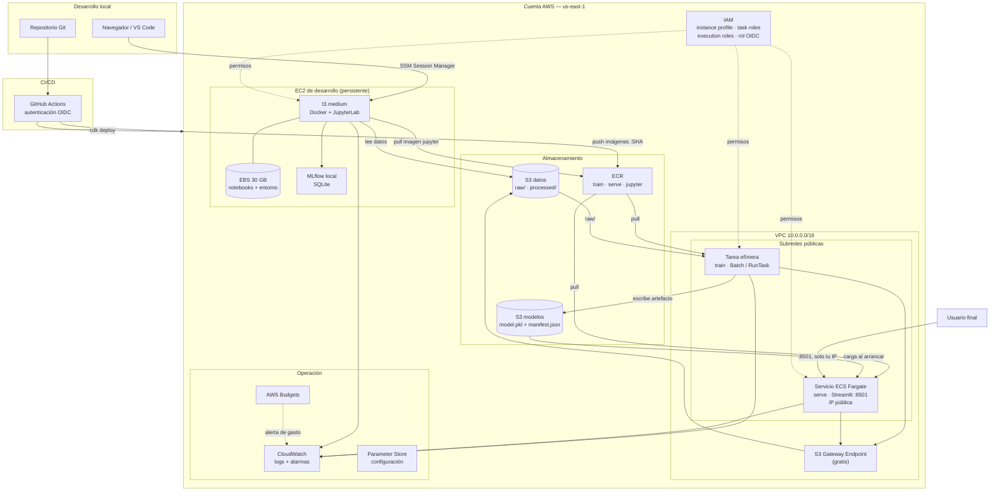
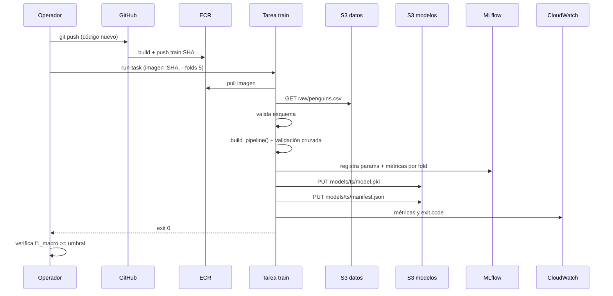
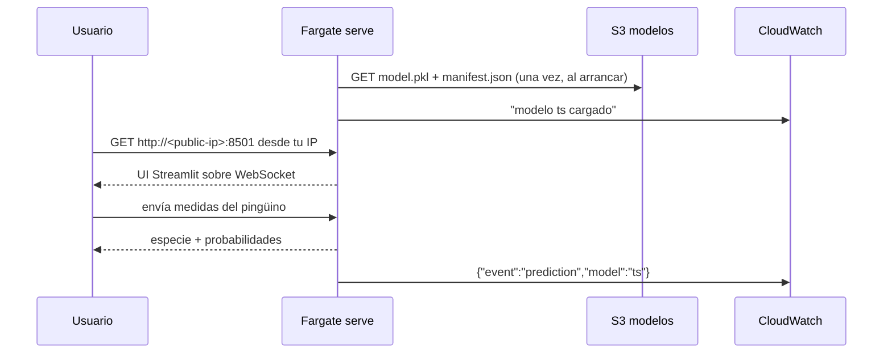
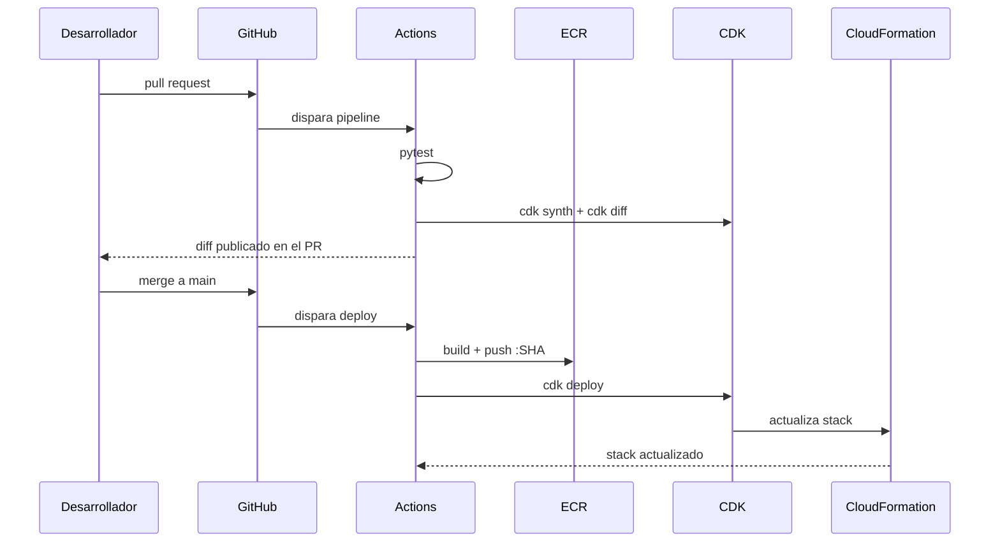

# Diagramas — Arquitectura final

Vista completa del proyecto terminado (estado al final de la Fase 5).
Sin NAT Gateway ni ALB: el acceso es directo a la IP pública, acotado por security groups.

---

## 1. Topología completa

---

## 2. Flujo de entrenamiento

---

## 3. Flujo de inferencia

---

## 4. Flujo de despliegue

---

## 5. Qué existe en cada fase

| Componente | Fase 1 | Fase 2 | Fase 3 | Fase 4 | Fase 5 |
|---|---|---|---|---|---|
| S3 datos + modelos | ✅ | ✅ | ✅ | ✅ | ✅ |
| ECR + imágenes | — | ✅ | ✅ | ✅ | ✅ |
| EC2 dev + EBS + SSM | — | — | ✅ | ✅ | ✅ |
| Tarea de entrenamiento | — | manual | ✅ job | ✅ | ✅ |
| Fargate serve | — | — | ✅ IP pública | ✅ | ✅ |
| CloudWatch + alarmas | — | básico | ✅ | ✅ | ✅ |
| Budgets + tags | ✅ | ✅ | ✅ | ✅ | ✅ |
| CI/CD con OIDC | — | — | — | — | ✅ |
| MLflow | — | — | ✅ | ✅ | ✅ |

---

## 6. Costo del estado final

| Recurso | Estado en reposo | Costo aproximado |
|---|---|---|
| S3 (datos + modelos) | siempre | < $1/mes |
| ECR (3 imágenes) | siempre | < $1/mes |
| EBS 30 GB | siempre | ~$2.40/mes |
| EC2 dev | apagada de noche | ~$10/mes |
| Fargate serve | scale to zero | < $2/mes |
| Public IPv4 (2 direcciones) | siempre, mientras existan las tareas | ~$3.65 c/u · ~$7.30/mes |
| **Total** | | **~$25/mes** |

El IPv4 público reemplazó al NAT y al ALB como costo fijo de red: se paga por dirección
(~$3.65/mes cada una), no por una pieza de infraestructura que el proyecto no usa.
