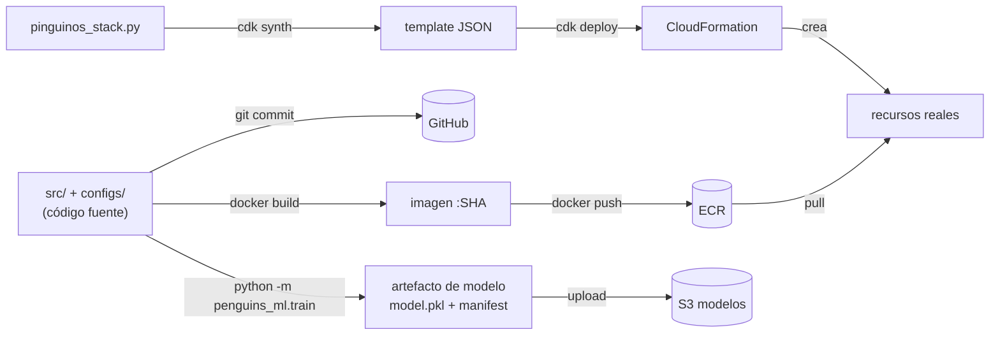
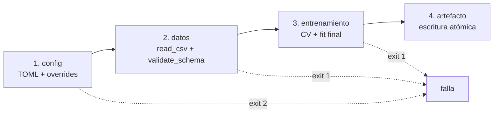
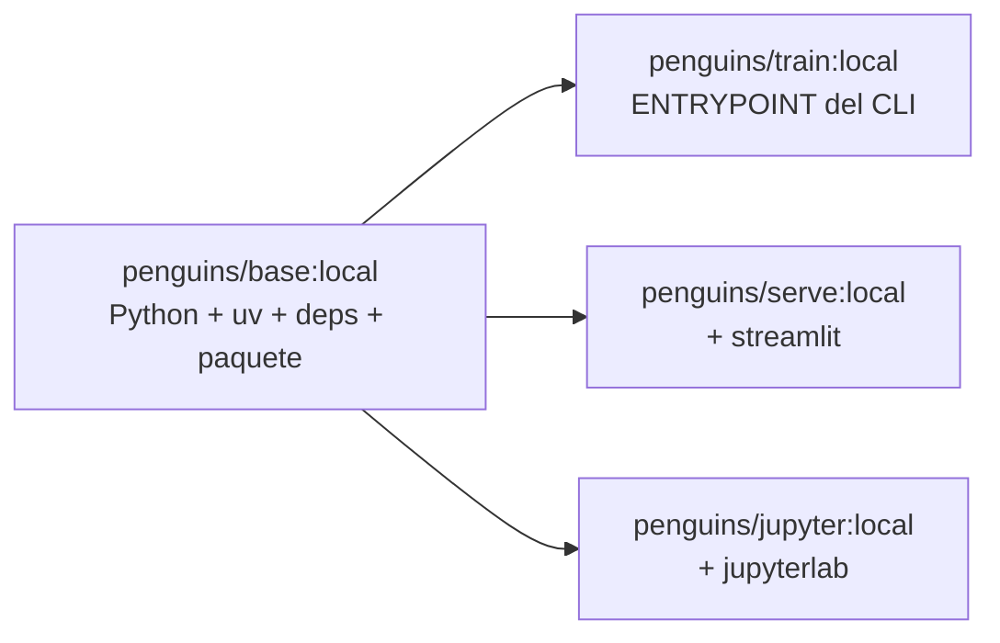
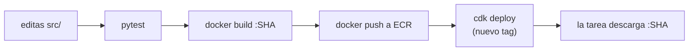
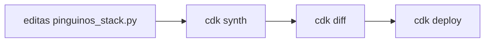
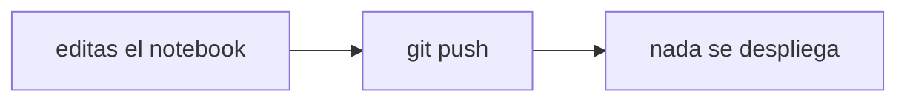
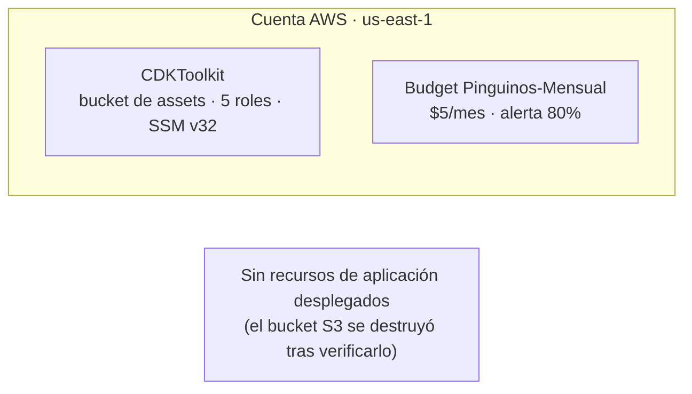
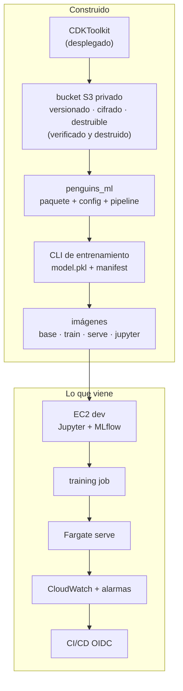

# Cómo funciona este proyecto — apuntes vivos

> **Documento vivo.** Se actualiza al cerrar cada issue.
> Última actualización: 2026-11-07 · Fase actual: 1 (imágenes y contenedores)

Este documento no reemplaza a `architecture.md` (el *qué*) ni a
`implementation-plan.md` (el *en qué orden*). Es el **modelo mental**: cómo encajan
las piezas y cómo se mueve un cambio desde tu editor hasta la nube.

---

## Cómo usar este documento

- Léelo antes de cada sesión de trabajo. Son 5 minutos y te devuelve el contexto.
- Al cerrar un issue, se actualizan: la tabla de estado (§10), el mapa acumulado (§11) y
  el registro de cambios (§12).
- Si algo de aquí contradice al código, **el código gana** y este documento se corrige.

---

## 1. La regla que ordena todo

**Tu código no corre en la nube. Lo que corre es una imagen.**

Esa frase resuelve el 80 % de la confusión inicial. Tu laptop tiene archivos `.py`; la nube
tiene contenedores ejecutándose. Entre ambos hay dos artefactos intermedios: el commit y la
imagen.

Corolario: **editar un archivo no cambia nada en la nube**. Hace falta un camino completo
hasta el despliegue.

---

## 2. Los cuatro artefactos

| Artefacto | Lo produce | Vive en | Contiene |
|---|---|---|---|
| **Código** | `git commit` | GitHub | La fuente de verdad |
| **Imagen** | `docker build` | ECR | Python + dependencias + tu paquete |
| **Modelo** | `python -m penguins_ml.train` | `artifacts/` → S3 | `model.pkl` + `manifest.json` + `cv.json` |
| **Template** | `cdk synth` | `cdk.out/` → CloudFormation | Qué recursos deben existir |



Ninguno reemplaza a otro:

- El código no corre en la nube. **La imagen corre.**
- La imagen no sabe dónde vive. **El template lo decide.**
- El template no contiene tu lógica. **Solo declara recursos.**
- El **modelo** no se construye: se **produce ejecutando** el entrenamiento. La imagen es
  el código; el artefacto es el resultado. Cambiar el modelo no exige reconstruir la imagen.

---

## 3. Cómo se acomoda el código

```text
pinguinos/
├── src/penguins_ml/          ← el paquete: se instala DENTRO de las imágenes
│   ├── config.py             ← lee y valida la config
│   ├── data.py               ← load_dataframe() (stub) + validate_schema()
│   ├── transforms.py         ← build_pipeline(): compartido por train y serve
│   ├── provenance.py         ← hashes, git, fingerprint y manifest
│   ├── train.py              ← ENTRYPOINT de la imagen train
│   └── serve.py              ← ENTRYPOINT de la imagen serve (stub hasta #7)
├── configs/
│   ├── base.toml             ← qué entrenar
│   ├── local.toml            ← dónde, en tu laptop
│   └── cloud.toml            ← dónde, en AWS
├── Dockerfile.base           ← Python + uv + deps + el paquete
├── docker/
│   ├── train.Dockerfile      ← FROM base + ENTRYPOINT train
│   ├── serve.Dockerfile      ← FROM base + extra serve + Streamlit
│   └── jupyter.Dockerfile    ← FROM base + extras dev/jupyter + JupyterLab
├── scripts/
│   └── build-images.sh       ← construye base -> train/serve/jupyter
├── docker-compose.yml        ← levanta Jupyter local
├── .dockerignore             ← qué NO entra al contexto de build
├── pinguinos/                ← CDK: describe la infraestructura
│   └── pinguinos_stack.py
├── notebooks/                ← NUNCA se despliega
└── tests/
```

**La pieza que hace que todo funcione:** `src/penguins_ml/` se instala en **las dos**
imágenes. Por eso el preprocesamiento no puede divergir entre entrenamiento e inferencia:
es literalmente el mismo código.

`train.py` y `serve.py` son dos puertas de entrada al mismo edificio. Uno entrena, el otro
predice, y ambos importan `transforms.py`.

---

## 4. El entrenamiento y su artefacto

El CLI `python -m penguins_ml.train` corre en **cuatro fases**, y cada una falla antes
de la siguiente:



| Fase | Qué hace | Si falla |
|---|---|---|
| **1. Config** | `load_config(*paths)` + overrides de CLI | exit **2** (error de uso) |
| **2. Datos** | `read_csv` + `validate_schema` + `folds ≤ clase minoritaria` | exit **1** |
| **3. Entrenamiento** | `cross_validate` para métricas y después `fit` sobre todo el dataset | exit **1** |
| **4. Artefacto** | escritura atómica en `artifacts/<run_id>/` | exit **1** |

La salida es un **directorio**, no un archivo:

```text
artifacts/<run_id>/
├── model.pkl        ← Pipeline completo (preprocesador + estimador)
├── manifest.json    ← procedencia: de dónde salió
└── cv.json          ← métricas por fold
```

### Por qué tres archivos

| Archivo | Responde |
|---|---|
| `model.pkl` | "¿cómo predigo?" |
| `cv.json` | "¿cómo rindió en cada fold?" |
| `manifest.json` | "¿de dónde salió?" |

El manifest es el **contrato de procedencia**:

| Campo | Responde |
|---|---|
| `code.git_sha` / `git_dirty` | qué código lo produjo (y si había cambios sin commitear) |
| `data.etag` / `rows` / `bytes` | sobre qué bytes exactos se entrenó |
| `runtime` | con qué versiones de Python, sklearn y pandas |
| `config` + `config_hash` | con qué receta exacta |
| `config_sources` | qué capas de TOML se cargaron |
| `overrides` | qué se pisó por CLI |
| `cv` + `metrics` | cómo se evaluó |
| `tracking_uri` | reservado para la Fase 4 (MLflow) |

### La escritura es atómica

El artefacto se escribe primero en `artifacts/.tmp-<uuid>/` y recién al final se renombra
a `artifacts/<run_id>/`. Si el proceso muere a mitad, **no queda un artefacto parcial**:
un `.pkl` truncado que parece válido es peor que ninguno.

### Exit codes: el contrato con quien te lanza

| Código | Significado | Quién lo usa |
|---|---|---|
| `0` | Artefacto completo | ECS marca la task exitosa |
| `1` | Falla de ejecución | Reintentar o alertar |
| `2` | Error de config/uso | No reintentar: el input está mal |

En la nube nadie mira la pantalla: el **exit code** es la señal que usa ECS para decidir
si el entrenamiento fue exitoso.

### Corrida real

```bash
python -m penguins_ml.train \
  --config configs/base.toml \
  --config configs/local.toml
```

```text
INFO artefacto: artifacts/2026-11-06T19-43-15Z
INFO manifest: sha256:deb1b8cf...
INFO accuracy: 0.9913 +- 0.0116
INFO f1_macro: 0.9906 +- 0.0121
```

Que `accuracy` y `f1_macro` estén cerca no es casual: el dataset está moderadamente
balanceado. Si divergieran, `f1_macro` sería la señal de que una clase se está perdiendo.

---

## 5. Cómo se construyen las imágenes

No hay un Dockerfile por imagen. Hay **una base y tres derivadas**:



### Los archivos

| Archivo | Qué define |
|---|---|
| `Dockerfile.base` | Python 3.11 + uv + dependencias + el paquete |
| `docker/train.Dockerfile` | `FROM base` + entrypoint `python -m penguins_ml.train` |
| `docker/serve.Dockerfile` | `FROM base` + extra `serve` + Streamlit |
| `docker/jupyter.Dockerfile` | `FROM base` + extras `dev`/`jupyter` + JupyterLab |
| `.dockerignore` | qué **no** entra al contexto de build |
| `scripts/build-images.sh` | construye las cuatro en orden |
| `docker-compose.yml` | levanta Jupyter local |

### El orden es obligatorio

```bash
./scripts/build-images.sh          # base -> train / serve / jupyter
```

Las derivadas empiezan con `FROM penguins/base:local`. Si la base no existe, fallan con
`pull access denied`. Y si reconstruís la base, las derivadas **no** se actualizan solas:
son fotos, no referencias vivas.

### Qué entra y qué no

| Entra a la imagen | No entra |
|---|---|
| `src/`, `configs/`, `pyproject.toml`, `uv.lock` | `data/`, `.git`, `.venv`, `artifacts/`, `notebooks/` |

Datos y secretos se **montan** en runtime, nunca se hornean. Un secreto en una capa queda
para siempre, aunque lo borres después: `docker history` lo muestra.

### Procedencia dentro del contenedor

El `.git` no entra a la imagen (lo excluye `.dockerignore`), así que `git rev-parse` no
funciona adentro. El SHA se inyecta en el build:

```bash
docker build --build-arg GIT_SHA="$(git rev-parse HEAD)" ...
```

```dockerfile
ARG GIT_SHA=unknown
ENV PENGUINS_GIT_SHA=${GIT_SHA}
```

Y `provenance.py` lee primero `PENGUINS_GIT_SHA`; si no existe, usa git. Por eso el manifest
generado dentro del contenedor tiene el SHA real y no `unknown`.

### Tamaños medidos

| Imagen | Tamaño |
|---|---|
| `base` | 829 MB |
| `train` | 829 MB |
| `serve` | 1.24 GB |
| `jupyter` | 1.25 GB |

La diferencia entre 1.38 GB y 829 MB fue un `chown -R` después de instalar: en overlayfs
duplica el `.venv` en una capa nueva. Se evita con `COPY --chown` y `USER` **antes** del
`uv sync`.

### Cómo se ejecuta

```bash
# entrenar (data y artifacts montados)
docker run --rm \
  -v "$PWD/data:/app/data:ro" \
  -v "$PWD/artifacts:/app/artifacts" \
  penguins/train:local --config configs/base.toml --config configs/local.toml

# servir
docker run -d --name serve -p 8501:8501 penguins/serve:local

# jupyter
docker compose up jupyter
```

### Las tres reglas

1. Corre como `appuser` (uid 1000), **no root**.
2. **No contiene datos ni credenciales.**
3. En CI/ECR el tag es el SHA (`#9`); en desarrollo, `local`.

---

## 6. Los tres viajes de un cambio

Saber **cuál** de estos tres flujos estás haciendo es la habilidad operativa central.

### A) Cambias lógica de la aplicación



### B) Cambias infraestructura



### C) Cambias un notebook



El flujo C es el que más se confunde. **Un notebook no requiere deploy.** Es exploración,
no producción.

---

## 7. Cómo manipulas la infraestructura

**No con clics. Con Python.**

```python
# pinguinos/pinguinos_stack.py
bucket = s3.Bucket(
    self, "DataBucket",
    versioned=True,
    removal_policy=RemovalPolicy.DESTROY,
    auto_delete_objects=True,
)
```

Ese archivo **es** el panel de control. Cambias el archivo y CDK calcula la diferencia entre
lo que declaras y lo que existe.

| Comando | Qué hace | Toca AWS |
|---|---|---|
| `cdk synth` | Convierte tu Python en template | No |
| `cdk diff` | Compara template vs realidad | Solo lee |
| `cdk deploy` | Aplica la diferencia | **Sí** |
| `cdk destroy` | Elimina el stack | **Sí** |
| `cdk bootstrap` | Prepara la cuenta y la región (una vez) | **Sí** |

Ciclo diario de infraestructura: `editar → synth → diff → deploy`. El `diff` es tu revisión
antes de tocar la cuenta.

---

## 8. Cómo se siente vivo

"Vivo" no es una sensación. Son **señales verificables**:

| Señal | Cómo la ves |
|---|---|
| El servicio responde | `curl http://<ip>:8501/_stcore/health` → `ok` |
| Alguien usó el modelo | una línea en CloudWatch con `"event":"prediction"` |
| La versión correcta sirve | el log dice `modelo <ts> cargado` |
| El pipeline produjo algo nuevo | el manifest en S3 cambió de timestamp |
| Nada se cayó | la alarma está en `OK`, no en `ALARM` |

**El momento en que se siente vivo** no es cuando despliegas: es cuando **rompes algo, lo ves
en los logs, lo arreglas y se recupera**. Ahí entiendes que hay un sistema, no una demo.

---

## 9. Las seis preguntas del especialista

No es saber más servicios. Es poder responder estas seis **sin abrir la consola**:

1. ¿Dónde corre esto exactamente?
2. ¿Qué versión está corriendo ahora?
3. ¿Qué pasa si se cae?
4. ¿Cuánto cuesta este mes?
5. ¿Puedo destruirlo y recrearlo desde cero?
6. ¿Cómo sé que está sano?

Un junior responde 1 y 2 mirando la consola. Un especialista responde las seis con comandos,
y sabe **qué le falta** cuando alguna no tiene respuesta.

---

## 10. Estado del proyecto

Actualizado al: **2026-11-07**

| Issue | Estado | Qué existe ya |
|---|---|---|
| #1 Línea base | ✅ cerrado | `docs/` commiteado · MFA en usuario y root · budget $5/mes · `CDKToolkit` v32 |
| #2 Bucket S3 | ✅ construido y destruido | Bucket privado, versionado, cifrado, `DESTROY` + `auto_delete_objects` · 3 tests · ciclo completo verificado **con un objeto dentro** |
| #3 Paquete | ✅ cerrado | `penguins_ml` instalable · `pyproject.toml` con grupos `dev`/`infra` · `uv.lock` (40 paquetes) · config TOML validada con Pydantic · 8 tests |
| #4 Pipeline + EDA | ✅ cerrado | `ColumnTransformer` + `Pipeline` · `categorical` validada contra `features` · `validate_schema` · EDA con tabla de decisiones · 20 tests |
| #5 Entrenamiento | ✅ cerrado | CLI en 4 fases · CV estratificada + `f1_macro` · `model.pkl` + `manifest.json` + `cv.json` · escritura atómica · exit codes `0/1/2` · 30 tests |
| #6 Imágenes | ✅ cerrado | `Dockerfile.base` + `train`/`serve`/`jupyter` · script de build · compose para Jupyter · no-root · sin datos · procedencia inyectada · 34 tests · 829 MB / 1.24 GB / 1.25 GB |
| #7 Streamlit local | ⬜ siguiente | Completar `serve.py` y consumir el artefacto real |
| #8 S3 + sin keys | ⬜ pendiente | — |
| #9 ECR | ⬜ pendiente | — |
| #10 EC2 dev | ⬜ pendiente | — |
| #11 Jupyter | ⬜ pendiente | — |
| #12 MLflow | ⬜ pendiente | — |
| #13 Training job | ⬜ pendiente | — |
| #14 Fargate serve | ⬜ pendiente | — |
| #15 Operación | ⬜ pendiente | — |
| #16 Alarmas y costo | ⬜ pendiente | — |
| #17 CI/CD | ⬜ pendiente | — |
| #18 Drill | ⬜ pendiente | — |

**Dos estados distintos que conviene no confundir:**

- **Construido** = existe el código, los tests y la capacidad de desplegarlo.
- **Desplegado** = existe ahora mismo en la cuenta.

Este proyecto trabaja en modo construir-y-destruir: lo construido persiste en git, lo desplegado
es efímero.

**Lo que existe hoy en AWS** (además del bootstrap):



---

## 11. Mapa acumulado

Este diagrama crece con el proyecto. Cada cierre de issue agrega su bloque.



---

## 12. Registro de cambios

| Fecha | Cambio |
|---|---|
| 2026-11-03 | Creación del documento. Issue #1 en curso: bootstrap completado, budget creado, MFA activo. |
| 2026-11-03 | Issue #1 cerrado. Issue #2 construido: bucket S3 privado, versionado, cifrado, con `DESTROY` + `auto_delete_objects`; 3 tests; ciclo deploy/destroy verificado con un objeto dentro. Se agrega la distinción construido ≠ desplegado. |
| 2026-11-03 | Issue #3 cerrado: paquete `penguins_ml`, `pyproject` con grupos, `uv.lock`, config TOML validada y 8 tests. El EDA se integra como **paso 0 del issue #4**, no como issue aparte, para no fragmentar el trabajo. |
| 2026-11-04 | Issue #4 cerrado: `ColumnTransformer` + `Pipeline`, `categorical` validada contra `features`, `validate_schema` y 20 tests. El EDA queda documentado en `notebooks/01_eda.ipynb`. |
| 2026-11-06 | Issue #5 cerrado: CLI de entrenamiento en 4 fases, CV estratificada con `accuracy` + `f1_macro`, manifest de procedencia, `cv.json`, escritura atómica y exit codes `0/1/2`. Verificado con 30 tests y una corrida real (0.9913 ± 0.0116). |
| 2026-11-07 | Issue #6 cerrado: `Dockerfile.base` + imágenes `train`/`serve`/`jupyter`, `.dockerignore`, script de build y compose para Jupyter. Corre como `appuser`, no contiene datos y la procedencia se inyecta por `--build-arg` (el `git_sha` ya no es `unknown`). Medido: 829 MB / 829 MB / 1.24 GB / 1.25 GB. Se agrega el capítulo §5. |

---

## 13. Referencias

| Documento | Rol |
|---|---|
| `docs/architecture.md` | El *qué*: componentes, decisiones, costos |
| `docs/implementation-plan.md` | El *en qué orden*: 8 fases con criterios de salida |
| `docs/diagrams.md` | Diagramas de topología y flujos de secuencia |
| `docs/how-it-works.md` | Este documento: modelo mental y apuntes de repaso |
| GitHub Issues #1–#18 | El trabajo concreto, uno por corte vertical |

---

## Conceptos que todavía no necesitas

Deliberadamente fuera hasta que el dolor aparezca:

- NAT Gateway, ALB, subredes privadas.
- EKS / Kubernetes.
- SageMaker Training Jobs y Model Registry.
- Múltiples cuentas y AWS Organizations.
- Service mesh, feature store, GPU.

Cada uno resuelve un problema real. Ninguno es el tuyo todavía.
