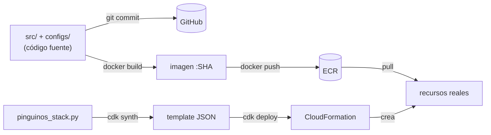
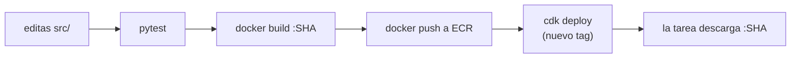
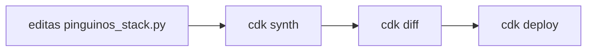
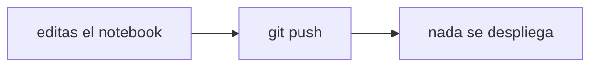
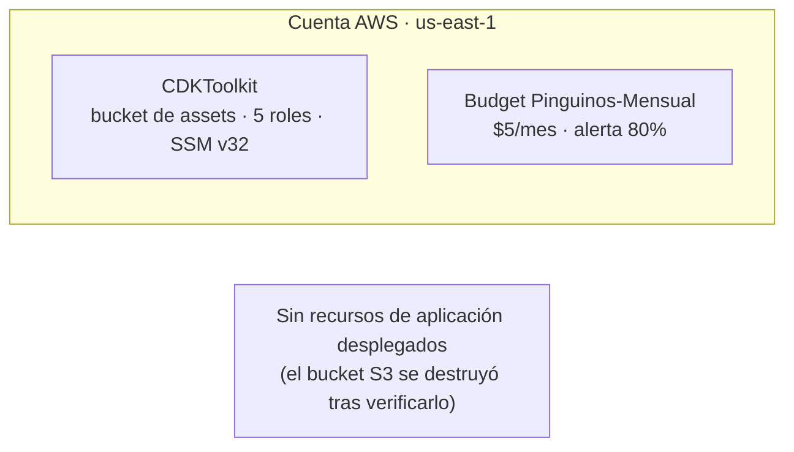
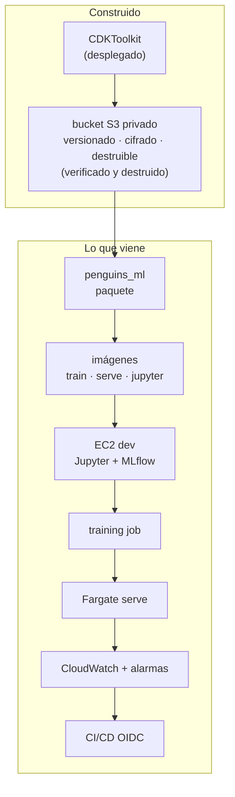

# Cómo funciona este proyecto — apuntes vivos

> **Documento vivo.** Se actualiza al cerrar cada issue.
> Última actualización: 2026-11-03 · Fase actual: 2 (bucket S3 construido y verificado)

Este documento no reemplaza a `architecture.md` (el *qué*) ni a
`implementation-plan.md` (el *en qué orden*). Es el **modelo mental**: cómo encajan
las piezas y cómo se mueve un cambio desde tu editor hasta la nube.

---

## Cómo usar este documento

- Léelo antes de cada sesión de trabajo. Son 5 minutos y te devuelve el contexto.
- Al cerrar un issue, se actualizan: la tabla de estado (§8), el mapa acumulado (§9) y
  el registro de cambios (§10).
- Si algo de aquí contradice al código, **el código gana** y este documento se corrige.

---

## 1. La regla que ordena todo

**Tu código no corre en la nube. Lo que corre es una imagen.**

Esa frase resuelve el 80 % de la confusión inicial. Tu laptop tiene archivos `.py`; la nube
tiene contenedores ejecutándose. Entre ambos hay dos artefactos intermedios: el commit y la
imagen.

Corolario: **editar un archivo no cambia nada en la nube**. Hace falta un camino completo
hasta el despliegue.

---

## 2. Los tres artefactos

| Artefacto | Lo produce | Vive en | Contiene |
|---|---|---|---|
| **Código** | `git commit` | GitHub | La fuente de verdad |
| **Imagen** | `docker build` | ECR | Python + dependencias + tu paquete |
| **Template** | `cdk synth` | `cdk.out/` → CloudFormation | Qué recursos deben existir |



Ninguno reemplaza a otro:

- El código no corre en la nube. **La imagen corre.**
- La imagen no sabe dónde vive. **El template lo decide.**
- El template no contiene tu lógica. **Solo declara recursos.**

---

## 3. Cómo se acomoda el código

```text
pinguinos/
├── src/penguins_ml/          ← el paquete: se instala DENTRO de las imágenes
│   ├── config.py             ← lee y valida la config
│   ├── data.py               ← carga desde S3
│   ├── transforms.py         ← build_pipeline(): compartido por train y serve
│   ├── train.py              ← ENTRYPOINT de la imagen train
│   └── serve.py              ← ENTRYPOINT de la imagen serve
├── configs/
│   ├── train.toml            ← qué entrenar
│   ├── local.toml            ← dónde, en tu laptop
│   └── cloud.toml            ← dónde, en AWS
├── docker/
│   ├── base.Dockerfile       ← Python + lockfile + el paquete
│   ├── train.Dockerfile      ← FROM base + ENTRYPOINT train
│   └── serve.Dockerfile      ← FROM base + ENTRYPOINT serve
├── pinguinos/                ← CDK: describe la infraestructura
│   └── pinguinos_stack.py
├── notebooks/                ← NUNCA se despliega
└── tests/
```

**La pieza que hace que todo funcione:** `src/penguins_ml/` se instala en **las dos**
imágenes. Por eso el preprocesamiento no puede divergir entre entrenamiento e inferencia:
es literalmente el mismo código.

`train.py` y `serve.py` son dos puertas de entrada al mismo edificio. Uno entrena, el otro
predice, y ambos importan `transforms.py`.

---

## 4. Los tres viajes de un cambio

Saber **cuál** de estos tres flujos estás haciendo es la habilidad operativa central.

### A) Cambias lógica de la aplicación



### B) Cambias infraestructura



### C) Cambias un notebook



El flujo C es el que más se confunde. **Un notebook no requiere deploy.** Es exploración,
no producción.

---

## 5. Cómo manipulas la infraestructura

**No con clics. Con Python.**

```python
# pinguinos/pinguinos_stack.py
bucket = s3.Bucket(
    self, "DataBucket",
    versioned=True,
    removal_policy=RemovalPolicy.DESTROY,
    auto_delete_objects=True,
)
```

Ese archivo **es** el panel de control. Cambias el archivo y CDK calcula la diferencia entre
lo que declaras y lo que existe.

| Comando | Qué hace | Toca AWS |
|---|---|---|
| `cdk synth` | Convierte tu Python en template | No |
| `cdk diff` | Compara template vs realidad | Solo lee |
| `cdk deploy` | Aplica la diferencia | **Sí** |
| `cdk destroy` | Elimina el stack | **Sí** |
| `cdk bootstrap` | Prepara la cuenta y la región (una vez) | **Sí** |

Ciclo diario de infraestructura: `editar → synth → diff → deploy`. El `diff` es tu revisión
antes de tocar la cuenta.

---

## 6. Cómo se siente vivo

"Vivo" no es una sensación. Son **señales verificables**:

| Señal | Cómo la ves |
|---|---|
| El servicio responde | `curl http://<ip>:8501/_stcore/health` → `ok` |
| Alguien usó el modelo | una línea en CloudWatch con `"event":"prediction"` |
| La versión correcta sirve | el log dice `modelo <ts> cargado` |
| El pipeline produjo algo nuevo | el manifest en S3 cambió de timestamp |
| Nada se cayó | la alarma está en `OK`, no en `ALARM` |

**El momento en que se siente vivo** no es cuando despliegas: es cuando **rompes algo, lo ves
en los logs, lo arreglas y se recupera**. Ahí entiendes que hay un sistema, no una demo.

---

## 7. Las seis preguntas del especialista

No es saber más servicios. Es poder responder estas seis **sin abrir la consola**:

1. ¿Dónde corre esto exactamente?
2. ¿Qué versión está corriendo ahora?
3. ¿Qué pasa si se cae?
4. ¿Cuánto cuesta este mes?
5. ¿Puedo destruirlo y recrearlo desde cero?
6. ¿Cómo sé que está sano?

Un junior responde 1 y 2 mirando la consola. Un especialista responde las seis con comandos,
y sabe **qué le falta** cuando alguna no tiene respuesta.

---

## 8. Estado del proyecto

Actualizado al: **2026-11-03**

| Issue | Estado | Qué existe ya |
|---|---|---|
| #1 Línea base | ✅ cerrado | `docs/` commiteado · MFA en usuario y root · budget $5/mes · `CDKToolkit` v32 |
| #2 Bucket S3 | ✅ construido y destruido | Bucket privado, versionado, cifrado, `DESTROY` + `auto_delete_objects` · 3 tests · ciclo completo verificado **con un objeto dentro** |
| #3 Paquete | ⬜ pendiente | — |
| #4 Pipeline | ⬜ pendiente | — |
| #5 Entrenamiento | ⬜ pendiente | — |
| #6 Imágenes | ⬜ pendiente | — |
| #7 Streamlit local | ⬜ pendiente | — |
| #8 S3 + sin keys | ⬜ pendiente | — |
| #9 ECR | ⬜ pendiente | — |
| #10 EC2 dev | ⬜ pendiente | — |
| #11 Jupyter | ⬜ pendiente | — |
| #12 MLflow | ⬜ pendiente | — |
| #13 Training job | ⬜ pendiente | — |
| #14 Fargate serve | ⬜ pendiente | — |
| #15 Operación | ⬜ pendiente | — |
| #16 Alarmas y costo | ⬜ pendiente | — |
| #17 CI/CD | ⬜ pendiente | — |
| #18 Drill | ⬜ pendiente | — |

**Dos estados distintos que conviene no confundir:**

- **Construido** = existe el código, los tests y la capacidad de desplegarlo.
- **Desplegado** = existe ahora mismo en la cuenta.

Este proyecto trabaja en modo construir-y-destruir: lo construido persiste en git, lo desplegado
es efímero.

**Lo que existe hoy en AWS** (además del bootstrap):



---

## 9. Mapa acumulado

Este diagrama crece con el proyecto. Cada cierre de issue agrega su bloque.



---

## 10. Registro de cambios

| Fecha | Cambio |
|---|---|
| 2026-11-03 | Creación del documento. Issue #1 en curso: bootstrap completado, budget creado, MFA activo. |
| 2026-11-03 | Issue #1 cerrado. Issue #2 construido: bucket S3 privado, versionado, cifrado, con `DESTROY` + `auto_delete_objects`; 3 tests; ciclo deploy/destroy verificado con un objeto dentro. Se agrega la distinción construido ≠ desplegado. |

---

## 11. Referencias

| Documento | Rol |
|---|---|
| `docs/architecture.md` | El *qué*: componentes, decisiones, costos |
| `docs/implementation-plan.md` | El *en qué orden*: 8 fases con criterios de salida |
| `docs/diagrams.md` | Diagramas de topología y flujos de secuencia |
| `docs/how-it-works.md` | Este documento: modelo mental y apuntes de repaso |
| GitHub Issues #1–#18 | El trabajo concreto, uno por corte vertical |

---

## Conceptos que todavía no necesitas

Deliberadamente fuera hasta que el dolor aparezca:

- NAT Gateway, ALB, subredes privadas.
- EKS / Kubernetes.
- SageMaker Training Jobs y Model Registry.
- Múltiples cuentas y AWS Organizations.
- Service mesh, feature store, GPU.

Cada uno resuelve un problema real. Ninguno es el tuyo todavía.
