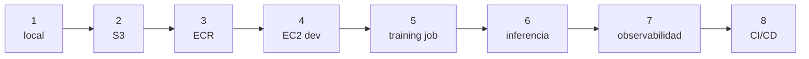

# Plan de implementación — Pinguinos

> Referencia de ejecución para tu primer proyecto en AWS.
> Complementa `docs/architecture.md` (el *qué*) con el *cómo* y el *en qué orden*.

El objetivo de este plan no es construir la plataforma más completa.
Es cerrar **ocho ciclos completos** —desplegar, verificar, destruir— sin
quemarte ni quemar el presupuesto. La arquitectura completa sin ciclos cerrados
no enseña nada; un ciclo cerrado enseña más que diez diagramas.

---

## 1. La diferencia entre el curso y la arquitectura

Skill Builder te enseña **qué hace cada servicio**. Arquitectura es **decidir bajo
restricciones**: cuánto cuesta en reposo, quién lo administra, qué pasa si se cae, y si
puedes borrarlo y recrearlo.

Usa estas cinco preguntas para cada componente que quieras agregar:

1. **¿Cuál es su ciclo de vida?** ¿Efímero, persistente o siempre disponible?
2. **¿Quién lo administra?** ¿Yo o AWS?
3. **¿Qué cuesta con cero tráfico?** (aquí mueren los principiantes)
4. **¿Puedo destruirlo y recrearlo desde cero?**
5. **¿Lo necesito ahora, o lo puedo posponer sin bloquearme?**

Si una pieza falla la pregunta 3 o la 4, no entra todavía.

---

## 2. Reglas de juego (no negociables)

Estas siete reglas son lo que hace que el proyecto sea "realista" y no un experimento
caro.

1. **IaC para escribir, consola solo para leer.** Si tocas la consola para crear algo, ese
   algo no existe en tu repo. Excepto depuración de solo lectura.
2. **Cero access keys.** Roles de IAM, instance profiles, task roles, `aws sso login`.
   Nunca una clave en un `.env`, en una imagen ni en un notebook.
3. **Presupuesto antes del primer deploy.** AWS Budgets con alerta en $5 y $20. Es gratis
   y es la única red que atrapa un recurso olvidado.
4. **Todo etiquetado.** `project=pinguinos`, `env=dev`, `owner=<tu-nombre>`.
5. **Todo destruible.** `cdk destroy` debe llevar el costo del mes a cero. Si no puede,
   está mal diseñado.
6. **Artefactos inmutables.** Imágenes con tag de SHA de git, modelos con manifest. Nunca
   `latest`, nunca "el último archivo".
7. **Destruye cada semana.** Excepto la EC2 de desarrollo, que apagas. Recrear todo desde
   cero es el hábito que más te va a enseñar.

---

## 3. Decisiones ya tomadas

Opiniones concretas para que no te bloquees decidiendo. Cuando tengas más criterio,
reviértelas.

| Decisión | Elección | Por qué |
|---|---|---|
| Herramienta IaC | **Solo CDK (Python)** | Ya lo tienes montado; mezclar Terraform y CDK es un error de primer proyecto |
| Región | **us-east-1** | Documentación y precios más favorables; la latencia no importa aquí |
| Cuentas | **Una sola cuenta** | Multi-cuenta y Control Tower son un proyecto en sí mismos |
| Red (fases 1–4) | **VPC default + subredes públicas + security groups** | Sin NAT y sin ALB: una sola tarea con IP pública no los necesita; los SG acotan el acceso |
| Cómputo de notebooks | **1 EC2 persistente, con auto-stop** | Es el flujo real de tu compañero y el más didáctico |
| Entrenamiento | **Job efímero (ECS `RunTask` o Batch)** | Es la diferencia entre "corrí un script" y "lancé un job" |
| Inferencia | **Fargate con IP pública + SG restringido a tu IP** | Sin ALB ni NAT; la IP cambia al reemplazar la tarea y se acepta por aprendizaje |
| Estado del modelo | **S3 + `manifest.json`** | Primitiva suficiente; MLflow/Model Registry vienen después |
| Tracking | **MLflow local en la EC2** | Barato y evita perder experimentos desde el día uno |
| Contenedores | **Imagen base compartida + 3 derivadas** | Evita tres entornos divergentes |
| Registro de imágenes | **ECR** | Sin registro, las imágenes viven solo en tu laptop |
| Acceso a la EC2 | **SSM Session Manager** | Sin puerto 22, sin `.pem`, con auditoría |

---

## 4. Las ocho semanas

Cada semana es un **corte vertical**: algo que funciona de punta a punta, aunque sea
delgado. No construyas dos semanas en paralelo.



### Semana 1 — Pipeline local containerizado (sin AWS)

**Objetivo:** probar que el pipeline funciona antes de que la nube pueda fallar.

- `src/penguins_ml/` con `transforms.py`, `train.py` (CLI) y `serve.py` (Streamlit).
- `Dockerfile.base`, `docker/train.Dockerfile`, `docker/serve.Dockerfile`,
  `docker/jupyter.Dockerfile`.
- `docker-compose.yml` para levantar Jupyter.
- Entrenamiento local con CV, escribe en `./artifacts/`.

**Criterio de salida:** `docker compose up` levanta Jupyter; entrenar produce
`artifacts/<ts>/model.pkl` + `manifest.json`; `serve.py` carga ese artefacto y predice.

**Riesgo:** intentar optimizar las imágenes. No lo hagas. Que funcionen.

---

### Semana 2 — S3 y el contrato del artefacto

**Objetivo:** el artefacto sale de tu laptop.

- Stack de CDK con un bucket: versionado, cifrado, bloqueo de acceso público.
- `train.py` acepta `--data-uri` y `--output-uri`.
- `aws configure sso` en tu máquina; **nunca** un IAM user con access keys.
- Subes `raw/penguins.csv` una vez.
- `serve.py` carga el modelo desde `s3://.../models/<ts>/`.

**Criterio de salida:** entrenas desde tu laptop, el artefacto aparece en S3, la
inferencia local lo carga desde S3.

**Riesgo:** permisos. Si falla, revisa primero el *bucket policy* y el *trust* del rol.

---

### Semana 3 — ECR e imágenes reproducibles

**Objetivo:** el artefacto deja de ser "mi laptop".

- Repositorio ECR con `image_scan_on_push=True` y regla de ciclo de vida.
- Build de la imagen base y de las tres derivadas; tag = SHA corto de git.
- `docker push` autenticado con `aws ecr get-login-password`.

**Criterio de salida:** desde una máquina limpia, `docker pull` desde ECR y correr la
imagen produce exactamente el mismo resultado. El SHA del tag coincide con `git rev-parse
--short HEAD`.

**Riesgo:** tamaños de imagen. Si la imagen pasa de ~1.5 GB, separa dependencias.

---

### Semana 4 — EC2 de desarrollo (el flujo "de empresa")

**Objetivo:** tu entorno de trabajo vive en AWS, no en tu laptop.

- CDK: EC2 `t3.medium` con EBS, IPv4 público, IAM instance profile acotado a tu bucket.
- **SSM Session Manager** habilitado. Sin puerto 22, sin keypair y sin ningún puerto de entrada:
  el agente abre 443 saliente.
- Contenedor de Jupyter con volúmenes montados (notebooks y datos en EBS).
- Auto-stop programado para las noches.
- MLflow local en la misma EC2 sobre SQLite.

**Criterio de salida:** entras por SSM (o VS Code Remote SSH vía SSM), levantas Jupyter,
`git pull`, y trabajas. Apagar y encender la instancia no pierde nada.

**Riesgo:** dejar la instancia encendida. Configura el auto-stop **antes** de empezar a
trabajar, no después.

---

### Semana 5 — Entrenamiento como job

**Objetivo:** la transición conceptual más importante del proyecto.

- `ECS RunTask` con la imagen `train`, o AWS Batch si prefieres cola.
- Task role con `s3:GetObject` en `raw/*` y `s3:PutObject` en `models/*`.
- El job recibe `--data-uri`, `--output-uri`, `--folds` por variables de entorno.
- Logs a CloudWatch con retención de 14 días.

**Criterio de salida:** un comando lanza el entrenamiento, no hay SSH involucrado, el
artefacto aparece en S3 y el log muestra las métricas por fold.

**Riesgo:** confundir *execution role* con *task role*. El primero arranca el contenedor;
el segundo es lo que el código puede hacer.

---

### Semana 6 — Inferencia en Fargate

**Objetivo:** cerrar el ciclo completo.

- Servicio Fargate con la imagen `serve`.
- Para aprender: IP pública + security group restringido a tu IP. Sin ALB (ahorra ~$16). La IP
  pública cambia cuando se reemplaza la tarea; se acepta por aprendizaje.
- Health check en `/_stcore/health`, carga del modelo una sola vez al arrancar.
- Escala a cero programada para cuando no demuestres.

**Criterio de salida:** abres la UI, predices, y el log dice qué versión del modelo
respondió. **Ese es el proyecto completo funcionando.**

**Riesgo:** cargar el modelo por request. Es el error de performance más común.

---

### Semana 7 — Observabilidad y control de costo

**Objetivo:** dejar de volar a ciegas.

- AWS Budgets: alerta en $5 y $20 (si no lo hiciste en la semana 1, hazlo ahora).
- Alarmas: tarea caída, CPU/memoria alta, logs de error.
- Etiquetas obligatorias en todos los recursos.
- Revisión de costo: ¿qué quedó encendido que no debería?

**Criterio de salida:** puedes responder "cuánto cuesta este proyecto al mes" desde la
consola de Cost Explorer, no desde tu memoria.

---

### Semana 8 — CI/CD

**Objetivo:** que desplegar no dependa de que tú estés en tu laptop.

- GitHub Actions con **OIDC** contra AWS (sin secretos estáticos).
- Pipeline: `pytest` → `cdk synth` → `cdk diff` → build/push → `cdk deploy`.
- `cdk diff` publicado como artefacto del PR.

**Criterio de salida:** merge a `main` despliega sin que nadie corra un comando local.

---

## 5. El primer paso, hoy

No empieces por el CDK. Empieza por el hábito:

```bash
# 1. Verifica quién eres en AWS (y en qué cuenta vas a gastar)
aws sts get-caller-identity

# 2. Bootstrap una sola vez por cuenta/región
cdk bootstrap

# 3. Un stack con UN bucket y un budget
cdk deploy

# 4. Comprueba que existe
aws s3 ls

# 5. Destruye. Esto es lo que estás aprendiendo.
cdk destroy
```

Si ese ciclo de cinco pasos funciona, tienes la base. Todo lo demás es agregar piezas
dentro de ese mismo ciclo.

**No** desplegarás nada más hasta que ese loop sea aburrido de tanto repetirlo.

---

## 6. Las prácticas reales que sí importan

De todo lo que podrías copiar de una empresa, esto es lo que de verdad diferencia:

| Práctica | Por qué |
|---|---|
| IaC para todo, consola solo lectura | Reproducibilidad y revisión por PR |
| Roles, nunca access keys | Una key filtrada es un incidente de cuenta |
| Tags + budgets desde el día uno | El costo te sorprende solo si no lo miras |
| Artefactos inmutables (SHA) | Rollback real y auditoría |
| Secretos en SSM / Secrets Manager | No en imágenes, no en `.env` |
| Retención de logs | El default es infinito |
| Todo destruible | La disciplina que hace barato experimentar |
| Un `manifest` por modelo | Responde "¿de dónde salió esta predicción?" |

Lo que **no** importa en tu primer proyecto, aunque suene impresionante: Kubernetes,
multi-cuenta, service mesh, feature store, GPU, data lake con capas.

---

## 7. Anti-objetivos de la v1

Escríbelos en un lugar visible. Cuando te tiente agregarlos, mira la lista.

- ❌ EKS / Kubernetes
- ❌ Multi-cuenta / AWS Organizations / Control Tower
- ❌ Terraform mezclado con CDK
- ❌ SageMaker (hasta sentir el dolor de hacerlo a mano)
- ❌ Subredes privadas + NAT Gateway
- ❌ ALB / load balancer
- ❌ Dominio propio + Route53 + ACM
- ❌ WAF, Shield, GuardDuty
- ❌ Feature store, orquestador de workflows (Airflow/Step Functions)
- ❌ GPU

Cada uno es correcto en algún contexto. Ninguno es correcto en la semana 1.

---

## 8. Presupuesto

Objetivo: **menos de $25/mes**, con la EC2 apagada de noche.

| Componente | Costo aproximado |
|---|---|
| EC2 `t3.medium` con auto-stop | ~$10/mes |
| EBS 30 GB | ~$2.40/mes |
| S3 + ECR (pocos MB/GB) | < $1/mes |
| Fargate de inferencia (scale-to-zero) | < $2/mes |
| Public IPv4 (2 direcciones) | ~$7.30/mes |
| Entrenamiento (segundos, on-demand) | centavos |
| CloudWatch Logs (retención 14 días) | < $1/mes |
| **Total** | **~$25/mes** |

Trampas que multiplican esto sin que lo notes: instancia encendida 24/7 sin auto-stop
(~$30), NAT Gateway (~$32), ALB (~$16), EKS (~$73), logs sin retención.

---

## 9. Cómo saber que vas bien

Marca estas casillas. Si alguna falla, no avances de fase.

- [ ] Puedo destruir todo y recrearlo desde cero en menos de 30 minutos.
- [ ] No hay ningún cambio hecho a mano en la consola.
- [ ] No existe ninguna access key en el proyecto.
- [ ] Toda imagen tiene tag de SHA, ninguna dice `latest`.
- [ ] Todo modelo desplegado tiene `manifest.json` con `git_sha` y `dataset_etag`.
- [ ] Sé cuánto cuesta el proyecto este mes.
- [ ] Un pull request despliega sin que yo toque mi laptop.
- [ ] Puedo explicar por qué cada componente existe y qué pasaría si lo quito.

La última es la más importante. Si no puedes defender una pieza, probablemente no la
necesitas todavía.

---

## 10. Cuando algo falla (playbook)

El 90% de los errores de un primer proyecto caen en cinco categorías:

| Síntoma | Primera sospecha | Dónde mirar |
|---|---|---|
| Timeout al descargar imagen | Sin ruta a ECR | Internet Gateway, security group, subred pública |
| `AccessDenied` en S3 | Rol equivocado o prefijo mal escrito | Task role vs execution role, bucket policy |
| La tarea arranca y muere | Error en el entrypoint o falta una env var | CloudWatch Logs, exit code |
| `cdk deploy` falla a medias | Un recurso depende de otro que no existe | `cdk diff`, eventos del stack en CloudFormation |
| El modelo no carga | Versión de `scikit-learn` distinta | `manifest.json` vs `pip freeze` de la imagen |

Regla de depuración: **lee el log antes de cambiar el código.** El 80% de los "no
funciona" están escritos en CloudWatch con el nombre exacto del problema.

---

## 11. Cuándo parar

Para después de la Semana 6. En ese punto tienes el ciclo completo: datos → notebook →
entrenamiento → artefacto → inferencia. Todo lo demás es profundidad.

Después de la Semana 8, elige **una** línea según lo que te haya dolido más:

- Si el entrenamiento manual te molesta → **AWS Batch con Spot**.
- Si perder experimentos te molesta → **MLflow en serio**.
- Si la red te intriga → **VPC propia + subredes privadas + endpoints**.
- Si quieres el camino corporativo → **SageMaker Training Jobs + Model Registry**.

Elige una. No las cuatro.
